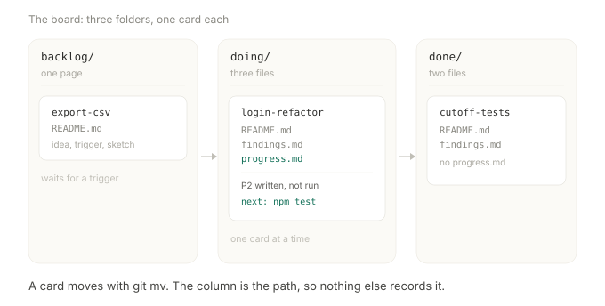
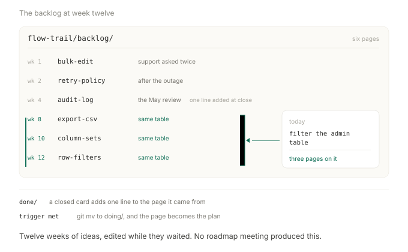
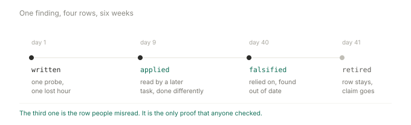
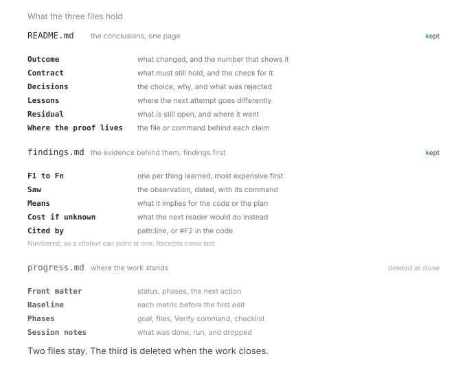
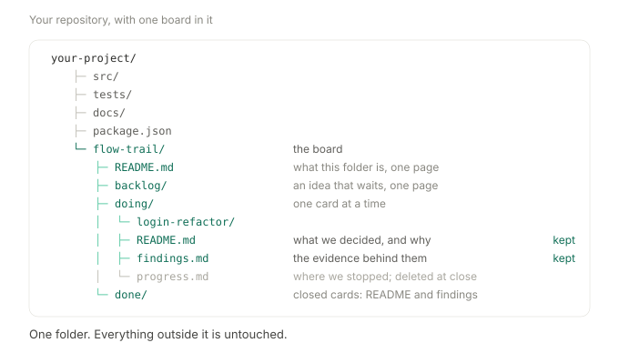

# flow-trail

**Your agent forgets everything between sessions. This is where the expensive parts go.**

Three folders in git, markdown inside, nothing running.

The code keeps what you chose. Nothing keeps what you turned down. So the next session proposes it
again, with enthusiasm, and you either argue it again or give in. That is the problem this solves,
and it is a smaller problem than most tools claim to.

## Get started

If the change is one commit, close this page: a board is for work that spans sessions.

Paste this at your agent, with the repository open:

```text
Install flow-trail in this repository:
  bash -c "$(curl -fsSL https://raw.githubusercontent.com/benxgao/flow-trail/HEAD/scripts/bootstrap.sh)"
Show me the output, and the version it prints last.
Do not edit AGENTS.md, .gitignore or flow-trail/ yourself.
Then tell me the sentence that opens the first card.
```

- One paste, and the same paste upgrades. The script asks the remote for its newest tag, downloads
  that release, and moves whichever install this repository already has: a copy owned by
  `npx skills`, or a link into `~/.flow-trail`.
- It links the skill, writes the `AGENTS.md` pointer, keeps the skill's source out of your
  `.gitignore`, and creates `flow-trail/`. Nothing else to configure.
- It reports each path it changed, `(already there)` for the ones it skipped, and ends on the
  version it read back from the manifest.
- By hand it is the same command, and `--dry-run` prints the plan without writing it:
  [install](docs/install.md).
- Claude Code, Codex, Copilot, Gemini, Cursor, WorkBuddy, DeepSeek Harness: the installer writes
  into the folder each one reads.

One release behind is the same paste. [upgrade](docs/upgrade.md) has the measurements, including
`npx skills update` printing `up to date` while it replaces twenty files, and the table of what
each release asked of a card.

Installed with `npx skills`? `~/.flow-trail` does not exist for that route: the scripts below are at
`<repo>/.agents/skills/flow-trail/scripts/`.

Then say what you want, in your own words:

| Say | What comes back |
| --- | --- |
| `plan the login refactor` | a card in `doing/`: baseline measured, phases, first one named |
| `park: csv export for the admin table` | one page in `backlog/`, with the trigger that starts it |
| `where were we?` | the `next:` line, the phase, and the decision behind it |
| `why not the secret check?` | the `## Decisions` row, and the option that lost |
| `close this card` | README and findings distilled, `progress.md` gone, `git mv` to `done/` |
| `this rename is one commit, skip it` | one row in `skips.md`, no folder |

- The reply is three lines: the path, the number it measured, the first phase. The plan is the card.



A board in motion, one card per column: [examples/](examples/). Open it and ask `where were we?`.

## Is it for you

| Reach for it when | Skip it when |
| --- | --- |
| a choice has to be explained months later | the change is one commit |
| the rejected option matters as much as the chosen one | one chat session finishes it |
| work pauses in one chat and resumes in another | you want a hosted board with a UI |
| a number has to hold up when its command is re-run | the plan is an agreement a team signs |
| ideas arrive faster than any of them can start | the roadmap has dates and owners |

- The right column is not a list of defects; each of those alternatives does a job this cannot.
- Scope: the board and the record. Running the work belongs to your assistant.

## More ideas than weeks

A plan arrives, and you cannot start it. It gets one page and a trigger, and it waits.

- Twelve weeks of that is a backlog nobody curated, and a roadmap nobody sat down to write.
- Pages are not frozen while they wait: a closed card writes its leftover line onto the page it
  came from, and a trigger that fires moves one into `doing/`.
- So the next feature starts by reading them, before the plan exists.



- The plan for today is one of those pages: `git mv backlog/<card> doing/<card>`, and the page
  becomes the card's README.
- The other five keep their trigger. One that no longer fits is edited, or deleted.
- Say `what in the backlog touches this?` before the plan. The answer is paths, not priorities.

## How you know it is working

Anything can produce a folder of notes. Two questions decide whether this one is worth keeping, and
both are commands rather than opinions.

**Is the record still true?**

```bash
bash ~/.flow-trail/scripts/verify-outcome.sh --run
# 12 rows: 11 ok, 1 manual, 0 drifted
```

Every number a card claims carries the command that produced it and an assertion that fails when it
stops being true. Ten months later the command still runs. A card that has drifted says so, which
is the point: you find out from a script, not from a bad afternoon.

**Has anyone used it?**

```bash
bash ~/.flow-trail/scripts/flow-trail-stats.sh
```

One row per card, then one line per time a later task actually used a finding. The headings look
like bookkeeping. They are four answers to four questions you would otherwise guess at:

| In the table | In plain words | Why it is worth a column |
| --- | --- | --- |
| `applied` | someone read it and did something differently | that is the hour you got back |
| `falsified` | someone relied on it and found it had expired | good news: the only proof anyone checked |
| no row at all | nobody has used it | useless, or unfindable. Opposite fixes |
| `area 5` | five commits touched the code this card is about | five chances to be read. Did any land? |



- `falsified` is the row people misread. It is not a defect report; it is the moment a claim stopped
  being able to waste an afternoon.
- A finding that cannot go wrong is a finding nobody checked.
- Nothing here needs a review meeting. A `Check` command fails, or a `Dies when` date passes, and
  the row is due. That is the whole maintenance schedule.

For the agent reading this — three habits, in order:

1. `flow-trail-stats.sh` before starting, to see whether this area already has a card.
2. `verify-outcome.sh --run` before relying on an Outcome number.
3. One `usage.md` row before finishing, if a finding changed what you did.

Details, including what a canary is and why one is planted: [evals](docs/evals.md).

## The board

```
flow-trail/
  backlog/   one page per idea: the problem, the trigger, why it waits
  doing/     the plan: phases, a baseline, a next action
  done/      the record: what changed, the numbers, what lost
```

| Column | A card holds | Leaves when |
| --- | --- | --- |
| `backlog/` | `README.md` — problem, trigger, sketch | someone starts it |
| `doing/` | `README.md`, `findings.md`, `progress.md` | every phase is verified |
| `done/` | `README.md`, `findings.md` | never |

- A card gains weight on the way right, then loses it: 1 file, 3 files, 2 files.
- `progress.md` is the only file that dies. It carries the state; the other two carry the work.
- `usage.md` sits beside the columns: one row each time a later task actually used a finding, so
  whether the record is being read is a number and not an opinion: [evals](docs/evals.md).

Three moves, and no dashboard:

| Move | What you do |
| --- | --- |
| Open a card | write `backlog/<card>/README.md` — problem, trigger, acceptance sketch |
| Start it | `git mv backlog/<card> doing/<card>`, then write `progress.md` |
| Close it | `git rm doing/<card>/progress.md`, then `git mv doing/<card> done/<card>` |

- One card in `doing/`, because `ls flow-trail/doing` is what says what is being built.
- A second card is two things half-built, and two `next:` lines no new session can tell apart.
- Nothing enforces it. The linter prints a warning; the decision stays with you.
- A card that is waiting says so in its own `next:` line, rather than moving backwards.

## What a card holds



- The headings: `Outcome`, `Contract`, `Decisions`, `Lessons`, `Residual`, `Where the proof lives`.
- The split is by lifetime. Two of the three files are still true when the work ends.
- A decision gets its row the session it is made, with the option that lost. Code keeps the winner.
- A phase carries a `Verify` command anyone can paste: [how phases work](docs/how-it-works.md).

## Why the column is the path



- There is no second record of status, so nothing falls out of date.
- `git mv` moves a card, `git log --follow` keeps its history, `git diff` shows the edit.
- A branch carries its own board. Merging two branches merges two cards.
- Readable in ten years, with or without this tool or any assistant.

## Where it fits

Four other tools keep a plan outside the chat, each pointed at a different job.

| Tool | What it is | Reach for it when |
| --- | --- | --- |
| [Superpowers][s1] | plugin: TDD, review, subagents | one job, one stretch, process held |
| [planning-with-files][s2] | three markdown files plus hooks | notes should renew on their own |
| [OpenSpec][s3] | spec tool: requirements, deltas | the change is an agreement to keep |
| [Beads][s4] | issue tracker in git, for agents | several agents share one queue |
| flow-trail | a board of folders, in git | the reason behind a choice, months later |

- Pick flow-trail when the answer has to survive the session, not just the task.
- Superpowers holds the process, OpenSpec holds the contract, Beads holds the queue.
- They are built for that. A directory of text is not.

## FAQ

- **Does this make my agent smarter?** No. It stops it from starting over. The model is what it was;
  it just stops re-proposing what you rejected in March.
- **Do I need all three columns?** No. `backlog/` is for ideas you mean to keep; open straight
  into `doing/` without it.
- **Do I need to know git?** Three commands, at the moves. Everything else is editing text.
- **Which assistants work?** Any that reads and writes files: Claude Code, Codex, Copilot,
  Gemini CLI, Cursor, WorkBuddy, DeepSeek Harness.
- **How do I see the board?** `ls flow-trail/*/`, or the lines the hook prints at session start.
  There is no view to refresh.
- **What if I stop using it?** The folders stay and stay readable. Nothing to uninstall.

The rest, on cost, merges, two people and a decision that turns out wrong:
[the full FAQ](docs/faq.md).

## Evidence

- **Five months on a real product.** 52 commits, 10 closed cards, before extraction.
- **The history here begins at extraction.** The 52 commits stayed in the source repository.
- **Tested twice blind.** Both runs changed the design: [design notes](references/design-notes.md).
- **Three columns, not five.** Four closing phases were completed 0 times in 7 plans.
- **Every rule states its measurement.** The docs are checked by a script.
- **The record answers back.** `verify-outcome.sh` re-runs every claimed number; a card that drifted
  reports it instead of waiting to be noticed.

## More

- [Example board](examples/) — mid-flight, three cards, ready to read.
- [Install](docs/install.md) — the paste block, what it writes, where each harness looks.
- [How it works](docs/how-it-works.md) — columns, files, phases, markers, closing.
- [FAQ](docs/faq.md) — the questions kept off this page.
- [Hooks](docs/hooks.md) — make it fire automatically, per harness.
- [Evals](docs/evals.md) — whether the record is read, and how to tell quiet from broken.
- [Design notes](references/design-notes.md) — every rule, and its measurement.

Try one card. If you never come back to it, it cost three files.

MIT. See [LICENSE](LICENSE).

[s1]: https://github.com/obra/superpowers
[s2]: https://github.com/OthmanAdi/planning-with-files
[s3]: https://github.com/Fission-AI/OpenSpec
[s4]: https://github.com/steveyegge/beads
