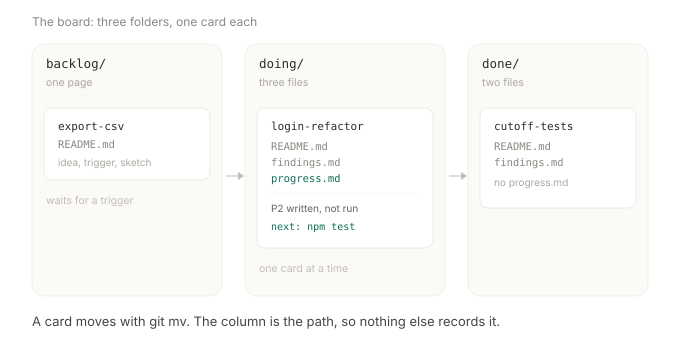
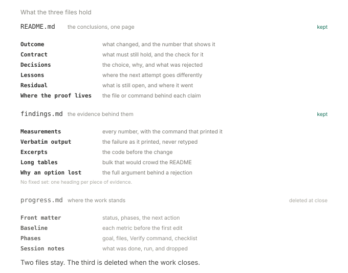
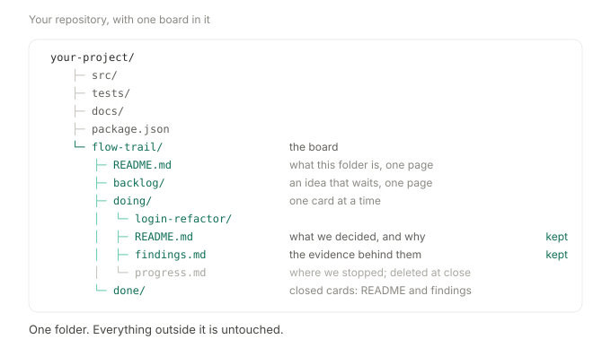

# flow-trail — a task board made of folders

**A task board for work that outlives one chat session: three folders in git, markdown inside.**

- `backlog/` → `doing/` → `done/`. The folder is the status; nothing else records it.
- A card is a folder of 1–3 files: what was decided, what was seen, where the work stopped.
- A move is `git mv`. The card keeps its history, and `git log --follow` still finds it.
- Any assistant that reads files can work the board. A person reads the same files in an editor.
- Nothing runs: no server, no database, no account, no token.

## Is it for you

| Reach for it when | Skip it when |
| --- | --- |
| a choice has to be explained months later | the change is one commit |
| the rejected option matters as much as the chosen one | one chat session finishes it |
| work pauses in one chat and resumes in another | you want a hosted board with a UI |
| a number has to hold up when its command is re-run | the plan is an agreement a team signs |

- The right column is not a list of defects; each of those alternatives does a job this cannot.
- Scope: the board and the record. Running the work belongs to your assistant.

## Get started

```bash
npx skills add benxgao/flow-trail -g
```

- Measured on Claude Code. WorkBuddy and editors that read only `AGENTS.md` need one more step;
  [install](docs/install.md) names it.

Then say what you want, in your own words. No config, no folder to create:

| Say | What comes back |
| --- | --- |
| `plan the login refactor` | a card in `doing/`: baseline measured, phases, first one named |
| `park: csv export for the admin table` | one page in `backlog/`, with the trigger that starts it |
| `where were we?` | the `next:` line, the phase, and the decision behind it |
| `why not the secret check?` | the `## Decisions` row, and the option that lost |
| `close this card` | README and findings distilled, `progress.md` gone, `git mv` to `done/` |
| `this rename is one commit, skip it` | one row in `skips.md`, no folder |

- The reply is three lines: the path, the number it measured, the first phase. The plan is the card.
- The first card in a repo also writes `flow-trail/README.md` and the `AGENTS.md` pointer.

Codex, Copilot, Gemini, Cursor, WorkBuddy, DeepSeek Harness: [install](docs/install.md).



A board in motion, one card per column: [examples/](examples/). Open it and ask `where were we?`.

## The board

```
flow-trail/
  backlog/   one page per idea: the problem, the trigger, why it waits
  doing/     the plan: phases, a baseline, a next action
  done/      the record: what changed, the numbers, what lost
```

| Column | A card holds | Leaves when |
| --- | --- | --- |
| `backlog/` | `README.md` — problem, trigger, sketch | someone starts it |
| `doing/` | `README.md`, `findings.md`, `progress.md` | every phase is verified |
| `done/` | `README.md`, `findings.md` | never |

- A card gains weight on the way right, then loses it: 1 file, 3 files, 2 files.
- `progress.md` is the only file that dies. It carries the state; the other two carry the work.

Three moves, and no dashboard:

| Move | What you do |
| --- | --- |
| Open a card | write `backlog/<card>/README.md` — problem, trigger, acceptance sketch |
| Start it | `git mv backlog/<card> doing/<card>`, then write `progress.md` |
| Close it | `git rm doing/<card>/progress.md`, then `git mv doing/<card> done/<card>` |

- One card in `doing/`, because `ls flow-trail/doing` is what says what is being built.
- A second card is two things half-built, and two `next:` lines no new session can tell apart.
- Nothing enforces it. The linter prints a warning; the decision stays with you.
- A card that is waiting says so in its own `next:` line, rather than moving backwards.

## What a card holds



- The headings: `Outcome`, `Contract`, `Decisions`, `Lessons`, `Residual`, `Where the proof lives`.
- The split is by lifetime. Two of the three files are still true when the work ends.
- A decision gets its row the session it is made, with the option that lost. Code keeps the winner.
- A phase carries a `Verify` command anyone can paste: [how phases work](docs/how-it-works.md).

## Why the column is the path



- There is no second record of status, so nothing falls out of date.
- `git mv` moves a card, `git log --follow` keeps its history, `git diff` shows the edit.
- A branch carries its own board. Merging two branches merges two cards.
- Readable in ten years, with or without this tool or any assistant.

## Where it fits

Four other tools keep a plan outside the chat, each pointed at a different job.

| Tool | What it is | Reach for it when |
| --- | --- | --- |
| [Superpowers][s1] | plugin: TDD, review, subagents | one job, one stretch, process held |
| [planning-with-files][s2] | three markdown files plus hooks | notes should renew on their own |
| [OpenSpec][s3] | spec tool: requirements, deltas | the change is an agreement to keep |
| [Beads][s4] | issue tracker in git, for agents | several agents share one queue |
| flow-trail | a board of folders, in git | the reason behind a choice, months later |

- Pick flow-trail when the answer has to survive the session, not just the task.
- Superpowers holds the process, OpenSpec holds the contract, Beads holds the queue.
- They are built for that. A directory of text is not.

## FAQ

- **Do I need all three columns?** No. `backlog/` is for ideas you mean to keep; open straight
  into `doing/` without it.
- **Do I need to know git?** Three commands, at the moves. Everything else is editing text.
- **Which assistants work?** Any that reads and writes files: Claude Code, Codex, Copilot,
  Gemini CLI, Cursor, WorkBuddy, DeepSeek Harness.
- **How do I see the board?** `ls flow-trail/*/`, or the lines the hook prints at session start.
  There is no view to refresh.
- **What if I stop using it?** The folders stay and stay readable. Nothing to uninstall.

Thirty-one more, on cost, merges, two people and a decision that turns out wrong:
[the full FAQ](docs/faq.md).

## Evidence

- **Five months on a real product.** 52 commits, 10 closed cards, before extraction.
- **The history here begins at extraction.** The 52 commits stayed in the source repository.
- **Tested twice blind.** Both runs changed the design: [design notes](references/design-notes.md).
- **Three columns, not five.** Four closing phases were completed 0 times in 7 plans.
- **Every rule states its measurement.** The docs are checked by a script.

## More

- [Example board](examples/) — mid-flight, three cards, ready to read.
- [Install](docs/install.md) — other harnesses, the hook, the two scripts.
- [How it works](docs/how-it-works.md) — columns, files, phases, markers, closing.
- [FAQ](docs/faq.md) — thirty-one questions kept off this page.
- [Hooks](docs/hooks.md) — make it fire automatically, per harness.
- [Design notes](references/design-notes.md) — every rule, and its measurement.

Try one card. If you never come back to it, it cost three files.

MIT. See [LICENSE](LICENSE).

[s1]: https://github.com/obra/superpowers
[s2]: https://github.com/OthmanAdi/planning-with-files
[s3]: https://github.com/Fission-AI/OpenSpec
[s4]: https://github.com/steveyegge/beads
